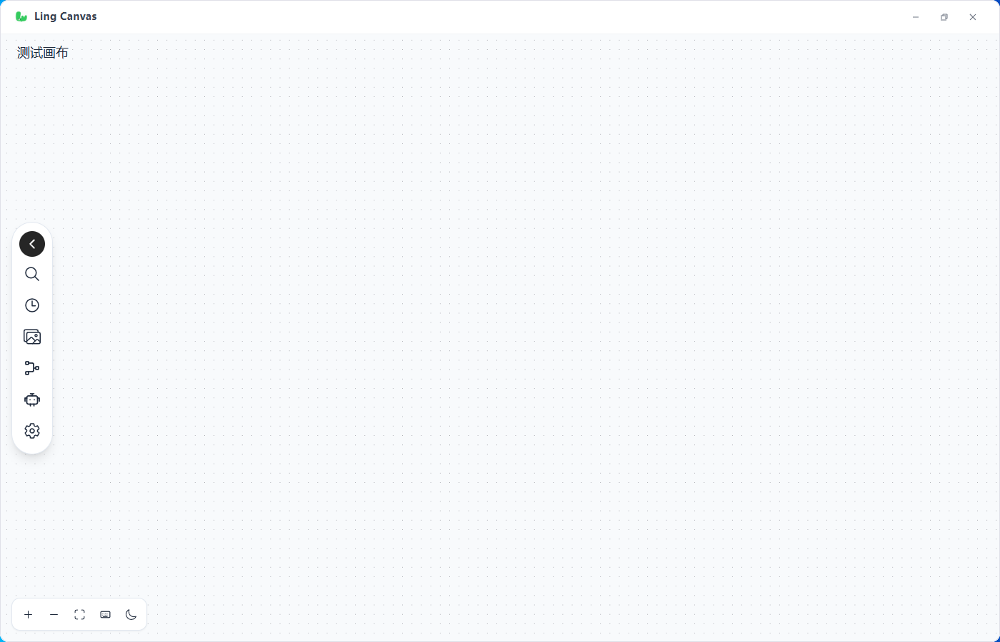
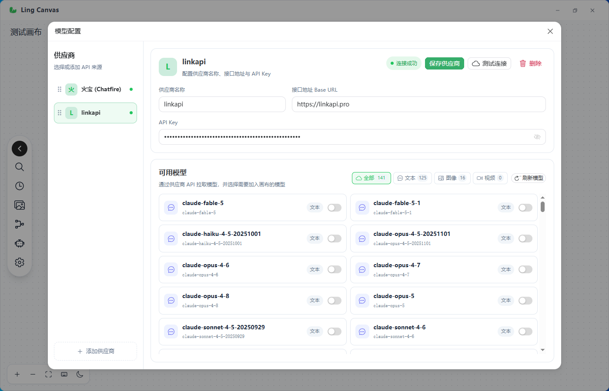

# Ling Canvas

Ling Canvas 是一个基于 Vue 3、Vue Flow 和 Tauri 2 的 AI 创作画布。把文字、图片、视频和音频放在同一张画布里，通过连线组织素材、编排生成任务，也可以连接本地智能体辅助创作。

当前源码版本：**2.1.3**。Windows 桌面版是主要使用方式，浏览器模式用于前端开发和预览。

[已发布安装包](https://github.com/ydd070622/ling-canvas/releases) · [反馈问题](https://github.com/ydd070622/ling-canvas/issues)

> 源码版本与 Release 安装包分别更新。2.1.3 已提交源码，本次未上传安装包；下载时请以 Release 页面标注的版本为准。

## 功能

- **节点画布**：拖拽、缩放、连线、分组、撤销与重做；选中节点后展开参数与操作。
- **图像与视频生成**：配置模型、提示词、比例和生成数量，连接参考素材；可用参数取决于模型与供应商。
- **底部输入栏**：基于当前选择创建任务，输入 `@` 引用画布素材。
- **室内渲染**：通过室内渲染节点组织单视角或多视角任务，共用结构、人物、灯光和环境参数。
- **素材管理**：本地文件夹、素材库、图片历史与批量结果整理。
- **本地智能体**：接入本机 Claude Code 或 Codex，配置命令路径、工作目录、模型及权限。
- **项目保存**：桌面版将项目与媒体保存在本机应用数据目录，支持多项目管理。
- **桌面窗口**：单实例运行、深浅主题，以及 Windows 系统托盘。

### Windows 窗口行为（2.1.3）

| 操作 | 行为 |
| --- | --- |
| 点击右上角 `—` | 普通最小化，保留任务栏窗口 |
| 点击右上角 `×` | 隐藏到系统托盘，从任务栏消失，应用和正在运行的任务继续运行 |
| 左键点击托盘图标 | 恢复主窗口 |
| 右键点击托盘图标 | 选择“打开主窗口”或“退出” |
| 再次启动应用 | 唤起已有窗口 |

需要完全关闭应用时，使用托盘菜单的“退出”。在画布中退出会先保存项目和媒体、持久化智能体对话，再销毁窗口。

## 开始使用

1. 从 [Releases](https://github.com/ydd070622/ling-canvas/releases) 下载 Windows x64 安装包并安装。
2. 打开设置中的“模型服务”，选择或添加供应商，填写接口地址和 API Key。
3. 点击“测试连接”或“刷新模型”，启用需要使用的模型。
4. 新建画布，添加文字或媒体素材，连接到生成节点后运行任务。

模型接口需要自行配置。不同供应商的图像、视频协议和参数存在差异；可在“高级配置 · 渠道兼容性”中调整，不能仅凭接口地址判断所有模型都可用。

如需使用本地智能体，先在本机安装并登录相应 CLI，再到设置的“智能体”页面配置和检测。模型服务的 API Key 与本地 CLI 的登录分别配置。

## 节点与连线

| 节点 | 用途 |
| --- | --- |
| 文本 | 输入文本、组织提示词或改写内容 |
| 图片 | 上传或生成图片，作为参考素材或输出结果 |
| 视频 | 上传或生成视频 |
| 音频 | 承载上传的音频素材并显示波形 |
| AI 任务 | 接收上游素材，组织生成指令与输出 |
| 室内渲染 | 按视角执行室内图像生成任务 |
| 图片对比 | 对比两张图片的前后效果 |
| 节点组 | 整理一组相关节点 |

连线用于向下游传递素材：文本可以补充提示词，图片等媒体可以作为参考。具体支持的素材类型、数量和作用由节点及模型决定。

输入栏中输入 `@` 可选择素材引用。自动模式会根据上游素材推断生成模式；首尾帧等能力还需要对应的视频模型支持。

“自动执行”会调用模型分析输入并创建工作流，当前编排器包含文生图、文生图生视频、分镜、多视角分镜和绘本类型。结果取决于意图分析与所配置模型的能力。

## 本地数据

Windows 桌面版的项目与媒体默认位于：

```text
%APPDATA%\com.lingcanvas.app\
├── projects\    # 项目 JSON 文档
└── media\       # 按项目保存的媒体
```

媒体存储位置可在设置中调整。浏览器开发模式使用 IndexedDB，与桌面版的数据存储环境不同。

覆盖安装不删除应用数据。卸载时如果勾选“删除应用程序数据”，会清除对应数据；备份时应同时保留项目文档和媒体目录。

## 本地开发

前端需要 Node.js 18 或以上及 pnpm。运行桌面版还需要 Rust、Windows C++ 构建工具和 WebView2 运行环境。

```bash
git clone https://github.com/ydd070622/ling-canvas.git
cd ling-canvas
pnpm install
```

### 浏览器预览

```bash
pnpm dev
```

浏览器模式可调试前端画布，但不能验证系统托盘、本地智能体进程和桌面文件访问等原生功能。

### 桌面开发

```bash
pnpm dev:tauri
```

### 构建

```bash
# 仅构建前端，输出到 dist/
pnpm build

# 构建 Windows 桌面应用和 NSIS 安装包
pnpm build:tauri
```

仓库的 [Cargo 配置](./src-tauri/.cargo/config.toml) 将默认构建目录设为 `E:/lc-target`，用于避开含空格路径下的 Windows GNU 资源编译问题。其他开发环境需要按本机路径调整，或通过 `CARGO_TARGET_DIR` 覆盖。

安装包位于构建目录的 `release/bundle/nsis/`。例如本次 2.1.3 使用 `src-tauri/target` 作为构建目录，产物为：

```text
src-tauri/target/release/bundle/nsis/Ling Canvas_2.1.3_x64-setup.exe
```

安装器模板与覆盖安装说明见 [NSIS 文档](./src-tauri/nsis/README.md)。

### 检查命令

```bash
pnpm verify:canvas
pnpm verify:gateway
cd src-tauri
cargo check --locked
```

`pnpm build` 也会执行 Vue 生命周期导入检查。更多专项检查位于 `scripts/`。

## 项目结构

```text
src/
├── api/           # 模型接口封装
├── components/    # 画布节点、设置与界面组件
├── composables/   # 可复用组合逻辑
├── config/        # 节点、模型与供应商配置
├── hooks/         # 生成与工作流逻辑
├── services/      # 存储、媒体及服务访问
├── stores/        # 状态管理
├── utils/         # 工具函数
└── views/         # 首页与画布页面
src-tauri/         # Rust 后端、桌面配置与安装器
scripts/           # 验证脚本
docs/              # 截图与设计文档
```

技术栈：Vue 3、Vite、Vue Flow、Pinia、Naive UI、Tailwind CSS、Tauri 2 和 Rust。

## 界面参考

以下是仓库保留的早期截图，供了解画布布局参考，界面细节以当前应用为准。

### 首页


### 画布



### 模型配置



## 反馈与贡献

欢迎通过 [Issues](https://github.com/ydd070622/ling-canvas/issues) 反馈问题，或提交 Pull Request。报告问题时请附上应用版本、复现步骤，以及相关日志或截图。
