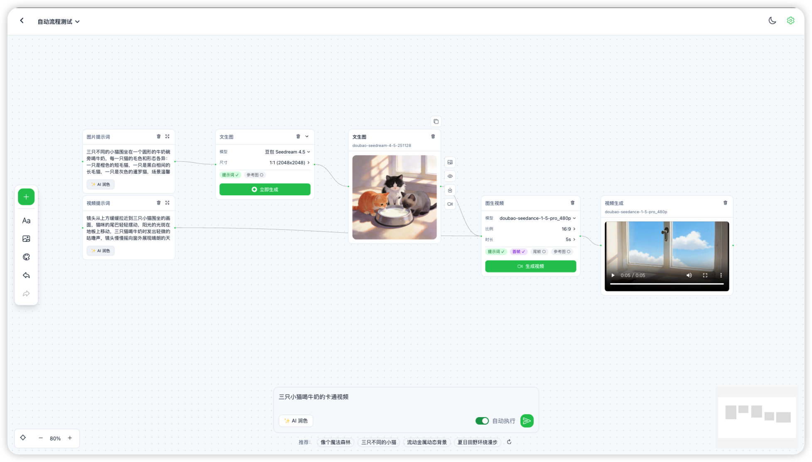
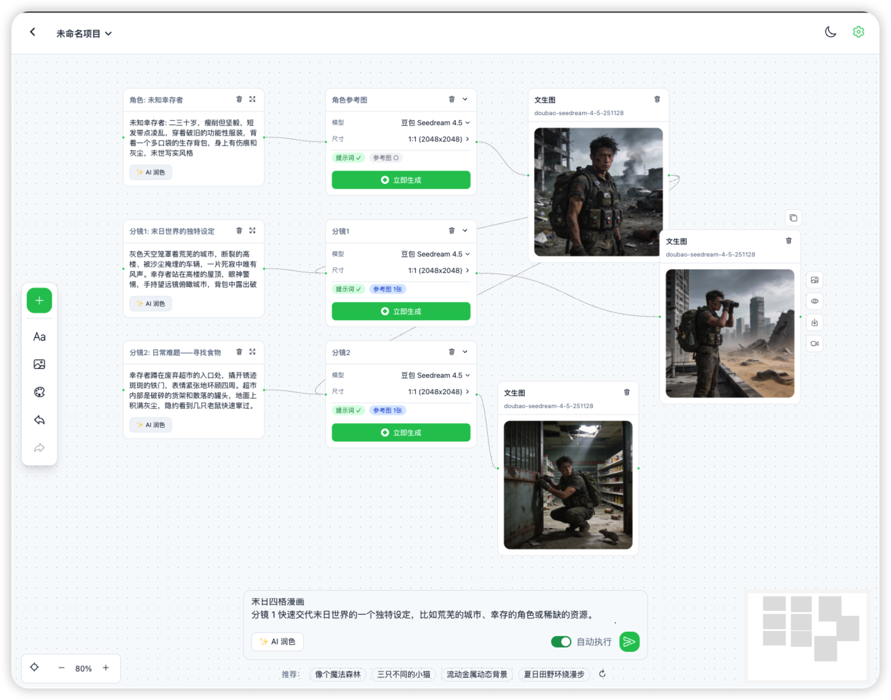

# Ling Canvas

Ling Canvas 是一个基于 Vue Flow 的可视化 AI 创作画布，支持文生图、视频生成等 AI 工作流的节点式编排。


## 📸 截图

### 首页


### 画布


### API 配置


## ✨ 特性

- 🎨 **可视化节点编排** - 基于 Vue Flow 的无限画布，支持拖拽、缩放、连接
- 🫧 **焦点态** - 节点平时只显示内容本身，选中一个才展开参数与操作条；展开/收起时视觉中心不动
- 💬 **底部 composer** - 选中的节点自动成为上下文，`@` 引用上游素材，一句话建出任务与一组输出
- 🖼️ **文生图工作流** - 支持配置提示词、模型、尺寸等参数生成图片
- 🎬 **视频生成工作流** - 支持图生视频，可设置首帧/尾帧图片
- 🤖 **AI 提示词润色** - 一键 AI 优化提示词，提升生成质量
- 🌓 **深色/浅色主题** - 支持主题切换，保护眼睛
- 💾 **本地项目存储** - 项目数据本地持久化，支持多项目管理
- ↩️ **撤销/重做** - 完整的操作历史记录

## 📦 节点类型

| 节点 | 描述 |
|------|------|
| **文本节点** | 输入、改写文本；正文即内容，改写指令在底部栏写 |
| **图片节点** | 上传或生成图片；模型 / 清晰度 / 比例 / 张数在底部栏设置 |
| **视频节点** | 上传或生成视频；清晰度·时长在底部栏设置 |
| **音频节点** | 承载上传的音频素材，波形按真实峰值绘制 |
| **AI 任务节点** | 生成入口：收下上游素材，产出写进下游输出节点 |
| **堆叠节点** | 把若干结果收成一叠，便于整理 |
| **节点组** | 整理一组相关内容节点，可随时取消分组 |

## 🔗 上游与引用

**连上就算用**：连进来的图片 / 视频会作为素材发给模型，文本会拼进提示词，
不需要额外写什么。

正文里也可以写 `@图片1` / `@文本2`（编号 = 该类型入边按连接顺序的位次）
来**在句子里指代某一个上游**；composer 里输入 `@` 会弹出候选。

生成模式（文生图 / 图生图 / 首尾帧…）已从卡片上撤掉，改由**实际连上来的上游**推断：
接一张图就是图生图，接两张就是首尾帧。旧项目里显式选过模式的节点保持原样。

## 🚀 快速开始

### 环境要求

- Node.js >= 18
- pnpm / npm / yarn

### 安装

```bash
# 克隆项目
git clone https://github.com/ydd070622/ling-canvas.git
cd ling-canvas

# 安装依赖
pnpm install
# 或
npm install

# 启动开发服务器
pnpm dev
# 或
npm run dev
```

### 构建

```bash
pnpm build
# 或
npm run build
```

## ⚙️ 配置

首次使用需要配置 API：

1. 点击右上角设置图标 ⚙️
2. 填入 API Base URL 和 API Key
3. 选择需要使用的模型

支持 OpenAI 兼容的 API 接口。

## 🛠️ 技术栈

- **框架**: [Vue 3](https://vuejs.org/) + [Vite](https://vitejs.dev/)
- **画布**: [Vue Flow](https://vueflow.dev/)
- **UI 组件**: [Naive UI](https://www.naiveui.com/)
- **样式**: [Tailwind CSS](https://tailwindcss.com/)
- **图标**: [@vicons/ionicons5](https://www.xicons.org/)
- **路由**: [Vue Router](https://router.vuejs.org/)

## 📁 项目结构

```
src/
├── api/          # API 请求封装
├── assets/       # 静态资源
├── components/   # 组件
│   ├── nodes/    # 节点组件
│   └── edges/    # 边组件
├── hooks/        # 组合式函数
├── router/       # 路由配置
├── stores/       # 状态管理
├── utils/        # 工具函数
└── views/        # 页面视图
```

## 🔄 自动执行工作流

开启「自动执行」模式后，系统会通过 AI 分析用户意图，自动编排并执行工作流。

### 工作流类型

| 类型 | 触发条件 | 说明 |
|------|---------|------|
| `text_to_image` | 默认 | 文生图工作流 |
| `text_to_image_to_video` | 包含"视频"、"动画"等关键词 | 文生图生视频工作流 |
| `storyboard` | 包含"分镜"、"场景"、"镜头"等关键词 | 分镜工作流 |

### 工作流 1: 文生图 / 文生图生视频



### 工作流 2: 分镜工作流 (Storyboard)



**示例输入:** `蜡笔小新去上学。分镜一：清晨的战争；分镜二：出发的风姿`

**AI 解析:**
- 提取角色: 蜡笔小新 (外观描述)
- 拆分分镜: 清晨的战争、出发的风姿

**执行流程:**
1. 生成角色参考图
2. 依次生成各分镜图片 (连接角色参考图保持一致性)

### 执行流程

1. **AI 意图分析** - 分析用户输入，判断工作流类型，生成优化后的提示词
2. **创建节点** - 按顺序创建文本、图片和视频内容节点
3. **依赖执行** - 根据连线等待必要的上游结果，再执行下游节点
4. **输出结果** - 结果保存在对应的图片或视频节点中

### 核心组件

- `useWorkflowOrchestrator` - 工作流编排器 Hook
- `waitForConfigComplete` - 等待配置节点完成
- `waitForOutputReady` - 等待输出节点就绪

## 🤝 贡献

欢迎提交 Issue 和 Pull Request！

1. Fork 本仓库
2. 创建特性分支 (`git checkout -b feature/amazing-feature`)
3. 提交更改 (`git commit -m 'Add amazing feature'`)
4. 推送到分支 (`git push origin feature/amazing-feature`)
5. 提交 Pull Request

## 联系我

扫码添加微信交流：


## 📄 License

[MIT](./LICENSE)
